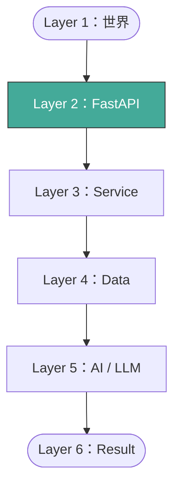

# 前言：FastAPI 在 AI 系統中的角色

> **定位**：這門課不是在教你寫 API，是在教你設計 AI 系統的邊界——沒通過 FastAPI 的資料，就不算進入系統。

## 學習目標

完成本節後，你應該能夠：
- 說出 AI 系統的六層架構，以及每層的責任
- 理解為什麼模型不該直接面對外部世界
- 判斷一個系統設計是否具備可追蹤性和可回溯性

---

## 情境

你加入了一間做 AI 風險判斷的公司。第一天看到架構圖，發現外部 webhook 直接打進 LLM，中間沒有任何驗證。

你問前輩：「這樣不會有問題嗎？」

前輩說：「模型很強，它自己會判斷。」

兩週後，模型收到一筆格式壞掉的 JSON，回了一個亂七八糟的結果，下游系統照做，客戶帳戶被誤封。

問題不在模型。問題在**沒有人守門**。

---

## 講解

### 六層架構

一個完整的 AI 系統，資料從外面進來到最後產出結果，會經過六層：

| 層級 | 角色 | 說明 |
|------|------|------|
| Layer 1：世界 | 不可控 | 使用者、裝置、外部系統——你無法控制它們送什麼過來 |
| Layer 2：FastAPI | 邊界守門 | Schema 驗證、定義什麼資料才算「合法事件」 |
| Layer 3：Service | 流程控制 | 商業邏輯、決定資料怎麼流 |
| Layer 4：Data | 資料處理 | 特徵工程、歷史整理 |
| Layer 5：AI / LLM | 推論 | 模型判斷，但只是「建議」 |
| Layer 6：Result | 閉環 | 記錄結果、驗證、回饋 |

這門課的主角是 **Layer 2**。FastAPI 不只是一個 web framework，它是系統的第一道防線。

### 為什麼模型不該直接面對世界？

模型的輸入品質決定輸出品質。如果沒有人在前面擋住垃圾資料：

- 格式壞掉的 JSON → 模型 crash 或回傳無意義結果
- 缺欄位 → 模型拿到 null，行為不可預測
- 惡意輸入 → prompt injection、資料污染

FastAPI 的責任就是確保：**通過我的資料，格式正確、語意合理、可被追蹤。**

### 三個核心特性

這門課設計的每一層 API，都要滿足：

| 特性 | 意思 | 怎麼做到 |
|------|------|---------|
| 可追蹤 | 每筆資料進來都有紀錄 | 事件化設計 |
| 可驗證 | 資料品質有保證 | Schema + Validation |
| 可回溯 | 出事能查是哪裡壞的 | 統一錯誤格式 + 事件紀錄 |

---

## Workshop

### 題目

一間公司要做智慧客服系統。外部 webhook 會送使用者的對話進來，系統要用 LLM 回覆。

請回答：

1. 畫出這個系統的六層架構（哪一層做什麼）
2. 如果 webhook 直接打進 LLM，會有什麼風險？（列舉至少 3 個）
3. FastAPI 這一層應該檢查什麼？

### 預期方向

- Layer 2 應該驗證：JSON 格式、必要欄位存在、對話內容非空
- 風險：格式錯誤導致 crash、prompt injection、無法追蹤是哪個使用者的請求
- LLM 只負責「根據乾淨的輸入產出回覆」，不該自己判斷輸入合不合法