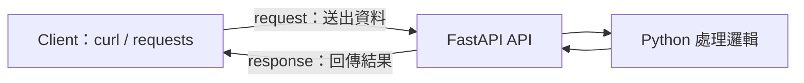
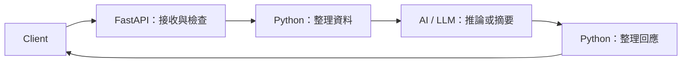

# 前言：FastAPI 在 AI 系統中的角色

> **定位**：用 FastAPI 建立一個可透過網路使用的入口，讓其他程式能送進資料、取得處理結果。

## 學習目標

完成本節後，你應該能夠：
- 區分 Client（發送請求的一方）與 Server（接收並處理請求的一方）
- 說出 FastAPI 在本課範例中的工作
- 理解資料檢查、處理邏輯與模型各自的責任

---

## 情境：程式寫好了，別人怎麼使用？

你已經用 Python 寫好一個程式，能整理事件資料，也能呼叫 AI 模型產生摘要。

現在，另一位同事想把他電腦上的事件送給你的程式處理。

直接把 Python 檔案交給他？他還得安裝環境、準備套件，並學會怎麼執行。

另一種做法是：讓你的程式持續提供服務，同事透過網路送出資料，再取得結果。這就是本課要實作的 API。

---

## Client 與 Server

| 角色 | 做什麼 | 本課的例子 |
|------|--------|------------|
| Client（客戶端） | 發送 request，讀取 response | curl、Python requests |
| Server（伺服端） | 接收 request，執行處理，再回傳 response | 我們用 FastAPI 建立的服務 |

request 是請求，response 是回應。先把它想成一次「送資料、收結果」的往返即可。

---

## FastAPI 負責哪一段？

FastAPI 是建立 Web API 的 Python 框架。在本課中，我們會用它定義：

1. **入口**：哪個網址接受什麼請求。
2. **資料格式**：需要哪些欄位、欄位有哪些限制。
3. **回應**：處理成功或失敗時，要回傳什麼。

例如，一筆事件漏了發生位置。如果這是系統處理時必需的欄位，我們就應該先回報缺少資料，讓送出的人修正。

FastAPI 搭配我們宣告的資料模型，可以協助檢查欄位與型別；要檢查哪些內容，仍需要開發者定義。

---

## 接上 AI 之後

處理邏輯可以整理資料、查詢紀錄，也可以呼叫模型。下面是本課可能使用的流程示意，實際專案可依需求調整。

| 工作 | 本課由誰負責 |
|------|----------------|
| 檢查必要欄位與數值範圍 | FastAPI 搭配資料模型及驗證程式 |
| 統計次數、整理歷史資料 | Python 處理邏輯，例如 Pandas |
| 產生推論結果或文字摘要 | AI / LLM |
| 記錄事件、處理錯誤、決定後續行動 | 我們撰寫的系統程式 |

**資料通過格式檢查，不代表內容一定真實、安全，或模型一定答對。** 身分權限、內容風險與處理紀錄，都需要依需求另外設計。

FastAPI 是本課選用的 API 工具；其他系統也可以採用不同框架或資料入口。

---

## 下一步

先從 Client 開始，用 curl 與 Python requests 向現成的 API 發送請求，觀察回應。理解這個往返後，再用 FastAPI 建立自己的 Server。
