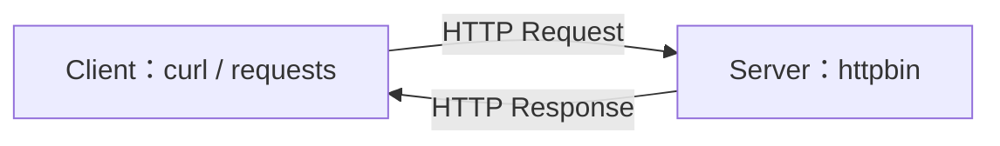

# 暖身：用 curl 與 requests 呼叫 API

> **定位**：先當 API 的使用者。用現成的 httpbin 服務，練習送出請求、讀取回應。

## 學習目標

- 用 curl 與 Python requests 呼叫 API。
- 分辨 URL 上的查詢參數與 JSON body。
- 看懂回應的狀態碼與資料。

## 情境：把一筆通道事件送出去

我們有一筆模擬資料：「aisle_01 通道被占用」。先練習把資料送到測試服務，確認對方收到什麼。

[httpbin](https://httpbin.org/) 會回傳收到的請求，適合練習；本章不會真的建立告警或保存事件。請使用模擬資料。



## 1. 用 curl 發送 GET

在終端機執行：

```bash
curl -i "https://httpbin.org/get?zone=aisle_01"
```

- `/get` 是這次呼叫的路徑。
- `?zone=aisle_01` 是查詢參數（query parameter）。
- `-i` 會一起顯示回應的狀態碼與 headers。

成功時，狀態碼為 `200`。回傳的 JSON 中，找找這一段：

```json
"args": {
  "zone": "aisle_01"
}
```

這是 httpbin 回傳的查詢參數，不是查到一筆真正的工廠紀錄。

## 2. 用 curl 發送 POST 與 JSON

```bash
curl -i -X POST "https://httpbin.org/post" \
  -H "Content-Type: application/json" \
  -d '{"event_type":"aisle_blocked","zone":"aisle_01"}'
```

- `-X POST`：指定 HTTP 方法。
- `-H`：設定 header，這裡說明 body 使用 JSON 格式。
- `-d`：放入要送出的資料。

回應的 `json` 欄位應包含：

```json
"json": {
  "event_type": "aisle_blocked",
  "zone": "aisle_01"
}
```

> 上面的換行寫法適用於 macOS / Linux 終端機。Windows PowerShell 可使用 `curl.exe`，並依終端機調整引號與換行。

## 3. 改用 Python requests

先在課程的虛擬環境中安裝：

```bash
python -m pip install requests
```

### GET：參數放在 params

```python
import requests

response = requests.get(
    "https://httpbin.org/get",
    params={"zone": "aisle_01"},
    timeout=10,
)

print(response.status_code)
print(response.json()["args"])
```

預期看到 `200`，以及 `{"zone": "aisle_01"}`（Python 印出的引號可能不同）。

### POST：資料放在 json

```python
import requests

event = {"event_type": "aisle_blocked", "zone": "aisle_01"}

response = requests.post(
    "https://httpbin.org/post",
    json=event,
    timeout=10,
)

print(response.status_code)
print(response.json()["json"])
```

`json=event` 會幫忙轉成 JSON，並設定對應的 Content-Type。`timeout=10` 用來避免連線或等待資料時一直卡住。

### 對照一下

| 要做的事 | curl | requests |
| --- | --- | --- |
| 查詢參數 | URL 的 `?zone=...` | `params={...}` |
| JSON body | `-H` 搭配 `-d` | `json={...}` |
| 回應狀態 | `-i` 顯示狀態碼 | `response.status_code` |
| 回應資料 | 終端機直接顯示 | `response.json()` 或 `.text` |

`response.json()` 是把回應解析成 Python 資料，不代表請求一定成功；也不是每個回應都有 JSON。

## Workshop：只寫 Client

### 任務 1：換一個查詢參數

把區域改成 `aisle_02`，分別用 curl 與 requests 發送 GET。

**驗收**：兩邊回應的 `args.zone` 都是 `aisle_02`。

### 任務 2：送出自己的模擬事件

使用 POST 傳送以下資料，先用 curl，再用 requests：

```json
{
  "event_type": "aisle_blocked",
  "zone": "aisle_02",
  "duration_seconds": 5
}
```

**驗收**：回應的 `json` 欄位包含這三個欄位；`duration_seconds` 是數字。

### 任務 3：看看非 200 的回應

```python
import requests

response = requests.get("https://httpbin.org/status/404", timeout=10)
print(response.status_code)
print(repr(response.text))
```

**觀察**：狀態碼是 `404`，body 為空；這時不要直接呼叫 `response.json()`。這個網址是 httpbin 專門用來模擬 404 的端點。

完成後，請指出每次請求的 **方法、URL、參數或 body，以及回應狀態碼**。

## 下一步

現在已經能呼叫別人的 API。下一章用 FastAPI 建立自己的入口，再用相同的 Client 呼叫它。

參考：[requests 官方 Quickstart](https://requests.readthedocs.io/en/latest/user/quickstart/)｜[httpbin](https://httpbin.org/)
