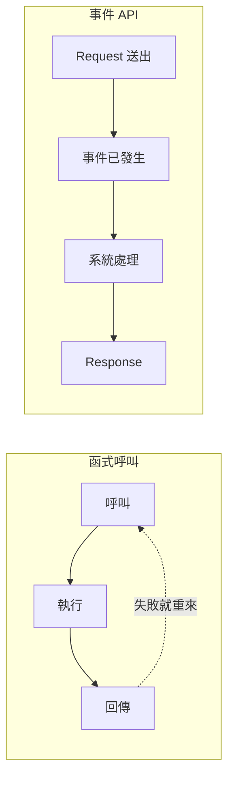

# 暖身：什麼是事件 API？

> **定位**：API 不是函式呼叫——每一次 request 都代表系統中發生了一件事，而且這件事不能撤回。

## 學習目標

完成本節後，你應該能夠：
- 區分「函式呼叫思維」和「事件思維」
- 把任何 API endpoint 重新理解成一個事件
- 說出為什麼 AI 系統特別需要事件化設計

---

## 情境

你寫了一個 function：

```python
def calculate_risk(user_id: int) -> float:
    return 0.85
```

參數不對？改了重跑。邏輯有 bug？修了重跑。這是函式呼叫的世界——可控、可重來。

但 API 不是這樣。

```
POST /transactions/evaluate
{"user_id": 123, "amount": 50000}
```

這個 request 一旦送出，事情就已經發生了。系統收到了一筆交易評估請求，不管你後來覺得 amount 打錯了，這筆「請求事件」已經存在。

---

## 講解

### 從函式到事件



| | 函式呼叫 | 事件 API |
|---|---------|---------|
| 環境 | 你的程式裡 | 跨系統、跨網路 |
| 可逆性 | 可以重跑 | 送出就發生了 |
| 失敗處理 | try/except | 需要記錄 + 回溯 |
| 追蹤性 | 通常不記錄 | 每次都該記錄 |

### 把 API 看成事件

任何 endpoint 都可以用三個問題來理解：

- **什麼事件？** → endpoint 名稱（event type）
- **內容是什麼？** → request body（event content）
- **系統怎麼回應？** → response（acknowledgment）

```
POST /login
→ 事件：使用者嘗試登入
→ 內容：帳號、密碼
→ 回應：成功 or 失敗

POST /upload-image
→ 事件：使用者上傳了一張圖片
→ 內容：圖片資料
→ 回應：已接收、處理中

GET /recommendations
→ 事件：使用者請求推薦
→ 內容：（query parameters）
→ 回應：推薦列表
```

連 GET 都是事件——「使用者在這個時間點請求了這個資料」這件事本身就值得記錄。

### 為什麼 AI 系統特別需要事件思維？

AI 系統有幾個特性讓事件化設計變得必要：

- **模型會錯** → 你需要知道當時輸入是什麼，才能回去分析
- **模型會改版** → 你需要用舊資料重跑新模型，比較結果
- **行為會漂移** → 你需要長期追蹤模型表現

如果 API 只是「呼叫 → 回傳」，這些事後分析全部做不到。但如果每次 request 都被當成事件記錄下來，你就有了完整的 audit trail。

---

## Workshop

### 題目

以下三個 API，請分別回答：

1. 這是什麼事件？
2. 事件內容（body）應該包含什麼？
3. 如果這個事件沒有被記錄，會有什麼風險？

```
POST /transactions/evaluate
GET /users/123/history
POST /alerts/dismiss
```

### 預期方向

| API | 事件 | 內容 | 不記錄的風險 |
|-----|------|------|-------------|
| POST /transactions/evaluate | 交易風險評估請求 | user_id, amount, timestamp | 無法回溯模型當時的輸入 |
| GET /users/123/history | 查詢使用者歷史 | query params（時間範圍等） | 不知道誰在什麼時候查了什麼 |
| POST /alerts/dismiss | 關閉警報 | alert_id, reason | 無法追蹤誰關了警報、為什麼關 |

---

原始課綱：[什麼是「事件 API」](https://hackmd.io/@yillkid/HkRCPlb4-x)
