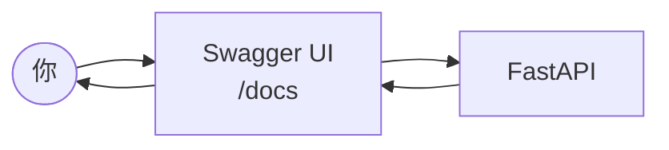
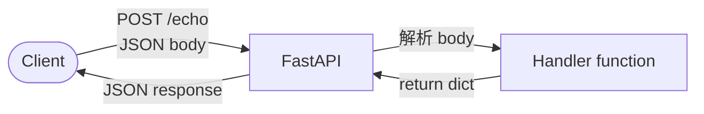

# FastAPI 快速上手

> **定位**：用最少的程式碼，把一個能收事件的 API 跑起來。

## 學習目標

完成本節後，你應該能夠：
- 啟動一個 FastAPI 服務
- 寫出 GET 和 POST endpoint
- 用 Swagger UI 測試 API
- 理解 request 進來、response 出去的基本流程

## 範例程式碼

- [demo](https://github.com/4-learn/fastapi-demo/tree/main/init)

---

## 情境

你要幫團隊建一個事件接收 API。不需要連資料庫、不需要商業邏輯，先把最基本的東西跑起來：能收 request、能回 response。

---

## 講解

### 安裝

```bash
pip install fastapi uvicorn
```

FastAPI 是框架，Uvicorn 是 ASGI server——FastAPI 定義怎麼處理 request，Uvicorn 負責實際接收和發送。

### 最小可運行的 API

```python
from fastapi import FastAPI

app = FastAPI()

@app.get("/")
def root():
    return {"message": "alive"}
```

三行程式碼，做了三件事：
1. 建立 app（系統邊界）
2. 定義 endpoint（`GET /`）
3. 回傳 JSON

### 啟動

```bash
uvicorn main:app --reload
```

`--reload` 是開發模式，改 code 自動重啟。打開瀏覽器到 `http://127.0.0.1:8000`，看到 `{"message": "alive"}` 就對了。

### Swagger UI

打開 `http://127.0.0.1:8000/docs`，FastAPI 自動幫你產生互動式 API 文件。



不用 curl、不用 Postman，直接在瀏覽器上測。之後每一章的 workshop 都可以用 Swagger 來驗證。

### 接收資料：POST endpoint

```python
from fastapi import FastAPI, Body

app = FastAPI()

@app.get("/")
def root():
    return {"message": "alive"}

@app.post("/echo")
def echo(data: dict = Body()):
    return {"received": data}
```

`POST /echo` 接收 JSON body，原封不動回傳。這就是最簡單的「收事件」——收到什麼，系統確認收到了。

### Request → Response 流程



FastAPI 自動處理：
- JSON 解析（body → Python dict）
- JSON 序列化（return dict → JSON response）
- HTTP status code（成功 200，驗證失敗 422）

---

## Workshop

### 題目

1. 啟動 FastAPI 服務，確認 Swagger UI 可以打開
2. 用 Swagger 測試 `GET /`，確認回傳 `{"message": "alive"}`
3. 用 Swagger 送一筆 JSON 到 `POST /echo`：

```json
{
  "event_type": "test",
  "user_id": 1
}
```

確認回傳：

```json
{
  "received": {
    "event_type": "test",
    "user_id": 1
  }
}
```

### 預期輸出

```json
{"received": {"event_type": "test", "user_id": 1}}
```

### 解答

- [解答](https://github.com/4-learn/fastapi-demo/tree/main/init)