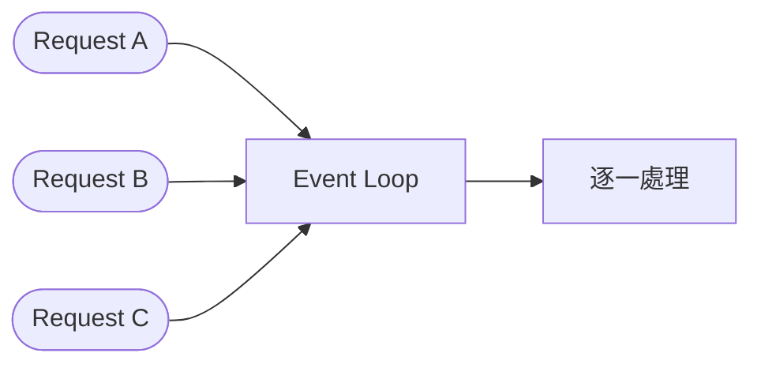

# 非同步：不要卡住你的 API

> **定位**：`async def` 不保證不阻塞——重點是你在裡面做了什麼。

## 學習目標

完成本節後，你應該能夠：
- 解釋為什麼一個 API 會「整個卡住」
- 區分 `time.sleep()` 和 `await asyncio.sleep()` 對 event loop 的影響
- 判斷什麼操作需要用 async，什麼不需要

## 範例程式碼

- [demo](https://github.com/4-learn/fastapi-demo/tree/main/async)

---

## 情境

QA 回報：「API 有時候整個不回應，等個幾秒又好了。」

你檢查了 server，CPU 不高、記憶體正常、沒有 crash log。但確實，打 `/ping` 偶爾會卡住。

後來你發現，每次卡住的時候，都有人同時在打另一個比較慢的 endpoint。那個 endpoint 裡面有一行 `time.sleep(5)`。

問題不是 FastAPI 慢。問題是那行 sleep 把整個 event loop 堵住了。

---

## 講解

### Event Loop 是什麼？

FastAPI 跑在一個 event loop 上面。簡單講，它是一條單線道：



所有 request 排隊進 event loop，一個一個處理。如果某個 handler 在裡面「不放手」，後面的 request 全部排隊等。

### 阻塞 vs 非阻塞

```python
import time
import asyncio

# 阻塞：霸佔 event loop，誰都不能動
async def blocking():
    time.sleep(5)  # 整條路堵死 5 秒
    return {"done": True}

# 非阻塞：暫時讓出來，其他 request 可以先走
async def non_blocking():
    await asyncio.sleep(5)  # 等待期間 event loop 繼續服務其他人
    return {"done": True}
```

差別只有一行，但效果完全不同：

| | `time.sleep(5)` | `await asyncio.sleep(5)` |
|---|---|---|
| Event loop | 堵住 | 繼續跑 |
| 其他 request | 等 5 秒 | 正常回應 |
| 效果 | 整個 API 卡死 | 只有這個 request 等 |

### 實際示範

```python
from fastapi import FastAPI
import time
import asyncio

app = FastAPI()

@app.get("/ping")
async def ping():
    return {"status": "pong"}

@app.get("/sync")
async def sync_api():
    time.sleep(5)
    return {"status": "done"}

@app.get("/async")
async def async_api():
    await asyncio.sleep(5)
    return {"status": "done"}
```

實驗方法：
1. 開兩個 terminal
2. Terminal A 打 `curl localhost:8000/sync`
3. Terminal B 立刻打 `curl localhost:8000/ping`
4. `/ping` 要等 `/sync` 做完才回——整個 API 被卡住了

換成 `/async`：
1. Terminal A 打 `curl localhost:8000/async`
2. Terminal B 立刻打 `curl localhost:8000/ping`
3. `/ping` 馬上回 `pong`——event loop 沒被堵住

### `async def` 不等於非阻塞

很多人以為加了 `async` 就沒事。不是的。`async def` 只是告訴 Python「這個 function 可以被 await」，但如果你在裡面做阻塞操作（`time.sleep`、同步的 DB query、同步的 HTTP request），一樣會堵住 event loop。

規則很簡單：**如果你在 async function 裡面呼叫的東西不是 `await`，它就是阻塞的。**

---

## Workshop

### 題目

1. 啟動 demo，用兩個 terminal 分別測試 `/sync` + `/ping` 和 `/async` + `/ping`，觀察差異
2. 解釋：`async def sync_api()` 明明有 `async`，為什麼還是會阻塞？
3. 把 `/sync` 的 `time.sleep(5)` 改成 `await asyncio.sleep(5)`，重新測試確認 `/ping` 不再被卡住

### 預期輸出

修改前（打 `/sync` 時 `/ping` 被卡住）：
```
# Terminal B 等了 5 秒才回
{"status": "pong"}
```

修改後（打 `/async` 時 `/ping` 正常）：
```
# Terminal B 馬上回
{"status": "pong"}
```

### 解答
- [Answer](https://github.com/4-learn/fastapi-workshop/tree/main/async)

---

原始課綱：[非同步、背景任務與「不要卡 API」](https://hackmd.io/@yillkid/SJFGtd1BZl)
