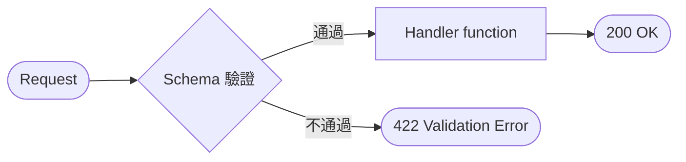

# Pydantic：Schema 就是合約

> **定位**：Schema 是系統對外的宣告——什麼樣的資料，我才承認它是合法事件。

## 學習目標

完成本節後，你應該能夠：
- 用 Pydantic BaseModel 定義 Schema
- 理解 Schema 的 fail-fast 機制（422 在邊界擋住）
- 知道 Schema 自動產生 Swagger 文件的好處

---

## 情境

你的 `POST /echo` 目前接 `dict`——什麼 JSON 都吃。

有人送了這個過來：

```json
{"usre_id": "abc", "amout": -100}
```

欄位名拼錯、型別也錯，但你的 API 照收，還回了 200。等這筆資料跑到下游 AI 模型，才炸出一個莫名其妙的錯誤。

問題在哪？你的 API 沒有定義「什麼才算合法輸入」。

---

## 講解

### Schema = 合約

Schema 不是「建議」，是合約。系統對外宣告：

> 「你要送 user_id（整數）、amount（浮點數）、currency（字串），三個都不能少。不符合？422，不處理。」

```python
from pydantic import BaseModel

class TransactionEvent(BaseModel):
    user_id: int
    amount: float
    currency: str
```

這三行做了很多事：
- `user_id: int` → 不是整數就拒絕
- `amount: float` → 不是數字就拒絕
- `currency: str` → 不能缺少

### Fail-Fast：在邊界擋住



重點：**Schema 驗證發生在 handler function 執行之前。** 資料不符合？function 根本不會被呼叫。不合法的資料永遠碰不到你的商業邏輯。

### 在 FastAPI 中使用

```python
from fastapi import FastAPI
from pydantic import BaseModel

app = FastAPI()

class TransactionEvent(BaseModel):
    user_id: int
    amount: float
    currency: str

@app.post("/transactions")
def receive_transaction(event: TransactionEvent):
    return {"status": "accepted", "event": event.model_dump()}
```

送合法資料：

```json
{"user_id": 123, "amount": 500.0, "currency": "TWD"}
```
→ 200，正常處理

送錯誤資料：

```json
{"user_id": "abc", "amount": 500.0}
```
→ 422，附上詳細錯誤訊息（哪個欄位、什麼問題）

### Swagger 自動產生文件

定義了 Schema，Swagger UI 會自動顯示：
- 每個欄位的名稱和型別
- 哪些欄位是 required
- 可以直接填資料測試

不用另外寫 API 文件，Schema 就是文件。

### Schema 帶來的信任

有了 Schema，handler 裡面可以放心用資料：

```python
@app.post("/transactions")
def receive_transaction(event: TransactionEvent):
    # 走到這裡，event.user_id 一定是 int
    # event.amount 一定是 float
    # event.currency 一定是 str
    # 不需要再自己檢查
    return process(event)
```

Schema 讓你在 handler 裡面不用寫一堆 `if event.user_id is None` 的防禦性程式碼。

---

## Workshop

### 題目

1. 定義一個 `TransactionEvent` Schema：`user_id`（int）、`amount`（float）、`currency`（str）
2. 建立 `POST /transactions` endpoint
3. 用 Swagger 測試：
   - 合法輸入 → 200
   - 缺欄位 → 422
   - 型別錯誤 → 422

### 預期輸出

合法：

```json
{
  "status": "accepted",
  "event": {
    "user_id": 123,
    "amount": 500.0,
    "currency": "TWD"
  }
}
```

缺 currency：

```json
{
  "detail": [
    {
      "loc": ["body", "currency"],
      "msg": "Field required",
      "type": "missing"
    }
  ]
}
```

### 解答

- [解答](https://github.com/4-learn/fastapi-workshop/tree/main/pydantic)

---

原始課綱：[Pydantic：Schema = 合約](https://hackmd.io/@yillkid/Skx5AvQVWx)
