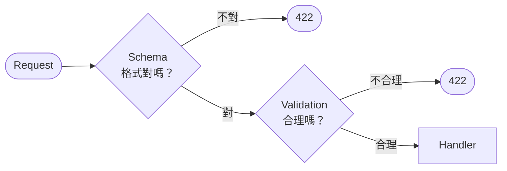

# 資料驗證：Schema 擋結構，Validation 擋語意

> **定位**：Schema 確保格式正確，但 amount = -9999 格式沒問題，語意有問題——Validation 處理這一層。

## 學習目標

完成本節後，你應該能夠：
- 區分 Schema（結構）和 Validation（語意）的差異
- 使用 Pydantic Field 設定數值範圍、長度限制
- 理解 Validation 發生在 handler 之前

---

## 情境

上一章你定義了 `TransactionEvent`，Schema 擋住了型別錯誤和缺欄位。

但有人送了這個：

```json
{
  "user_id": 123,
  "amount": -9999.0,
  "currency": "TWD"
}
```

Schema 通過了——`user_id` 是 int、`amount` 是 float、`currency` 是 str，格式完全正確。

但 -9999 的交易金額？這在你的系統裡不合理。Schema 不會管「合不合理」，它只管「格式對不對」。

---

## 講解

### Schema vs Validation



| | Schema | Validation |
|---|--------|-----------|
| 檢查什麼 | 型別、是否存在 | 數值範圍、長度、語意 |
| 例子 | user_id 是 int 嗎？ | user_id > 0 嗎？ |
| 問的問題 | 「格式對嗎？」 | 「合理嗎？」 |

### 用 Field 加上驗證規則

```python
from pydantic import BaseModel, Field

class TransactionEvent(BaseModel):
    user_id: int = Field(gt=0)            # 必須大於 0
    amount: float = Field(gt=0)           # 金額必須正數
    currency: str = Field(min_length=3, max_length=3)  # 貨幣代碼三碼
```

現在 `-9999` 會被擋住：

```json
{
  "detail": [
    {
      "loc": ["body", "amount"],
      "msg": "Input should be greater than 0",
      "type": "greater_than"
    }
  ]
}
```

### 常用驗證

| 需求 | Field 參數 | 範例 |
|------|-----------|------|
| 最小值 | `gt=0` 或 `ge=1` | 金額 > 0 |
| 最大值 | `lt=1000000` | 單筆上限 |
| 字串長度 | `min_length=3, max_length=3` | 貨幣代碼 |
| 正則 | `pattern=r"^[A-Z]{3}$"` | 三碼大寫英文 |

### Optional 欄位

有些欄位不一定每次都有：

```python
from typing import Optional

class TransactionEvent(BaseModel):
    user_id: int = Field(gt=0)
    amount: float = Field(gt=0)
    currency: str = Field(min_length=3, max_length=3)
    note: Optional[str] = None  # 可以不給
```

`note` 不存在 → OK。`note` 存在但是空字串 → 也 OK。Optional 就是「有就收，沒有也不會 422」。

### Validation 發生的時間點

跟 Schema 一樣，Validation 也在 handler 之前就執行完了。走到你的 function 時，資料已經通過所有檢查：

```python
@app.post("/transactions")
def receive_transaction(event: TransactionEvent):
    # 這裡的 event.amount 保證 > 0
    # event.currency 保證是三碼字串
    # 不需要再自己檢查
    return {"status": "accepted", "event": event.model_dump()}
```

---

## Workshop

### 題目

1. 把上一章的 `TransactionEvent` 加上 Validation：
   - `user_id` > 0
   - `amount` > 0
   - `currency` 剛好三個字元
2. 用 Swagger 測試以下情境：

| 輸入 | 預期 |
|------|------|
| `{"user_id": 123, "amount": 500, "currency": "TWD"}` | 200 |
| `{"user_id": -1, "amount": 500, "currency": "TWD"}` | 422 |
| `{"user_id": 123, "amount": -9999, "currency": "TWD"}` | 422 |
| `{"user_id": 123, "amount": 500, "currency": "TD"}` | 422 |

### 預期輸出

金額為負：

```json
{
  "detail": [
    {
      "loc": ["body", "amount"],
      "msg": "Input should be greater than 0",
      "type": "greater_than"
    }
  ]
}
```

### 解答

- [解答](https://github.com/4-learn/fastapi-workshop/tree/main/validation)