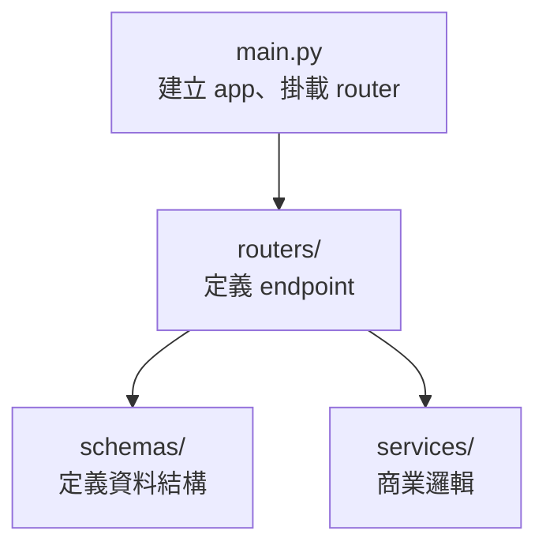

# 專案結構：模組化開發

> **定位**：main.py 不能無限長——拆成 router、schema、service，每個檔案只做一件事。

## 學習目標

完成本節後，你應該能夠：
- 說出四層架構（main → router → schema → service）各自的責任
- 把單檔 FastAPI 專案重構成模組化結構
- 在不改變 API 行為的前提下重新組織程式碼

## 範例程式碼

- [demo](https://github.com/4-learn/fastapi-demo/tree/main/struct)

---

## 情境

你的 Event API 跑起來了，但所有東西都塞在一個 `main.py` 裡：Schema、Validation、endpoint、商業邏輯，全部在同一個檔案。

200 行的時候還行。500 行開始不舒服。800 行的時候，你改一個 Schema，git diff 顯示改了 main.py，同事也改了 main.py，merge conflict。

問題不是 code 壞了，是**架構撐不住了**。

---

## 講解

### 四層責任



| 層級 | 檔案 | 責任 | 不該做的事 |
|------|------|------|-----------|
| main | `main.py` | 建立 app、掛 router、系統設定 | 寫 endpoint 邏輯 |
| router | `routers/events.py` | 定義 endpoint、接參數、回傳 | 寫商業邏輯 |
| schema | `schemas/event.py` | 定義 Pydantic model | 寫任何邏輯 |
| service | `services/event_service.py` | 處理商業邏輯 | 碰 HTTP 細節 |

### 最小可用結構

```
app/
├── main.py
├── routers/
│   └── events.py
├── schemas/
│   └── event.py
└── services/
    └── event_service.py
```

### 各層程式碼

**schemas/event.py** — 只定義資料結構：

```python
from pydantic import BaseModel, Field
from datetime import datetime
from typing import Any, Dict

class EventPayload(BaseModel):
    user_id: int = Field(gt=0)
    timestamp: datetime
    payload: Dict[str, Any]
```

**services/event_service.py** — 只處理邏輯：

```python
def handle_event(event_type: str, event, debug: bool):
    response = {
        "status": "accepted",
        "event_type": event_type,
        "user_id": event.user_id,
        "timestamp": event.timestamp.isoformat(),
    }
    if debug:
        response["payload"] = event.payload
    return response
```

**routers/events.py** — 只定義 endpoint：

```python
from fastapi import APIRouter, Body
from schemas.event import EventPayload
from services.event_service import handle_event

router = APIRouter(prefix="/events")

@router.post("/{event_type}")
def receive_event(
    event_type: str,
    debug: bool = False,
    event: EventPayload = Body()
):
    return handle_event(event_type, event, debug)
```

**main.py** — 只負責組裝：

```python
from fastapi import FastAPI
from routers.events import router

app = FastAPI(title="Event API")
app.include_router(router)
```

### 為什麼要拆？

| 單檔 | 模組化 |
|------|--------|
| 改 Schema → git diff 顯示改了 main.py | 改 Schema → git diff 顯示改了 schemas/event.py |
| 兩個人同時改 → merge conflict | 各改各的檔案 → 不衝突 |
| 測 service → 要 import 整個 app | 測 service → 只 import service function |
| 找 bug → 在 800 行裡翻 | 找 bug → 看檔名就知道在哪 |

拆開不是為了好看，是為了**可讀、可測、可協作**。

---

## Workshop

### 題目

把你在上一個 Workshop 寫的 Event API（單檔版本）重構成模組化結構：

1. 建立 `app/` 目錄和四個檔案
2. 把 Schema 搬到 `schemas/event.py`
3. 把邏輯搬到 `services/event_service.py`
4. 把 endpoint 搬到 `routers/events.py`
5. `main.py` 只做組裝

驗收標準：**API 行為完全不變**——同樣的 request、同樣的 response。

### 預期輸出

重構前後，打同一個 request 回傳結果一模一樣：

```json
{
  "status": "accepted",
  "event_type": "click",
  "user_id": 123,
  "timestamp": "2025-01-10T10:00:00"
}
```

### 解答

- [解答](https://github.com/4-learn/fastapi-workshop/tree/main/struct/app)