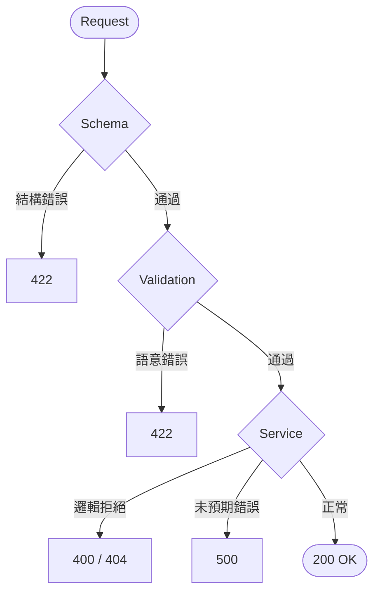
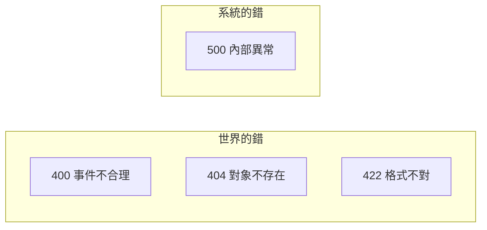

## Error Handling：系統邊界的錯誤處理

> **定位**：定義系統如何「拒絕」與「回應錯誤」

## 學習目標

完成本節後，你應該能夠：
- 區分「世界的錯」（400）與「系統的錯」（500）
- 自訂 Exception 類別與 Exception Handler
- 設計結構化的錯誤回應格式

## 範例程式碼

- [demo](https://github.com/4-learn/fastapi-demo/tree/main/error-handling)

---

## 情境

你的事件 API 已經有 Schema 和 Validation，能擋掉不合法的資料。

但現在遇到新問題：

> 事件格式正確，但系統「不想處理」或「無法處理」

例如：

- `event_type = "unknown_action"` — 系統不支援
- `user_id = 9999` — 使用者不存在
- Service 層發生預期外錯誤

這些情況，系統要嘛回 500，要嘛回看不懂的錯誤訊息。

問題不是「擋不擋」，而是「怎麼回應」。

---

## 講解

### 錯誤的層級

一個 request 進來，可能在不同階段失敗：



FastAPI 自動處理前兩層（422），但 Service 層的錯誤需要我們自己處理。

### 預設的 422 長這樣

```json
{
  "detail": [
    {
      "loc": ["body", "user_id"],
      "msg": "value is not a valid integer",
      "type": "type_error.integer"
    }
  ]
}
```

對串接的系統來說，這有幾個問題：

- 格式不統一（422 跟其他錯誤格式不同）
- 缺少事件上下文
- 無法追蹤

### 自訂 Exception

```python
class EventRejected(Exception):
    \"\"\"事件被系統拒絕（格式正確但邏輯不接受）\"\"\"
    def __init__(self, reason: str, event_type: str = "unknown"):
        self.reason = reason
        self.event_type = event_type
```

使用方式：

```python
@app.post("/events/{event_type}")
def create_event(event_type: str, event: EventBody):
    if event_type not in SUPPORTED_TYPES:
        raise EventRejected(
            reason=f"Unsupported event type: {event_type}",
            event_type=event_type
        )
    return {"status": "accepted"}
```

重點：**raise，不是 return。** 錯誤是「中斷」，不是「回傳」。

### 註冊 Exception Handler

```python
from fastapi.responses import JSONResponse

@app.exception_handler(EventRejected)
async def handle_event_rejected(request, exc):
    return JSONResponse(
        status_code=400,
        content={
            "status": "rejected",
            "event_type": exc.event_type,
            "reason": exc.reason
        }
    )
```

所有 `EventRejected` 都會回傳統一格式：

```json
{
  "status": "rejected",
  "event_type": "unknown_action",
  "reason": "Unsupported event type: unknown_action"
}
```

### 統一錯誤回應格式

建議所有錯誤遵循同一個結構：

```json
{
  "status": "rejected",
  "event_type": "...",
  "reason": "...",
  "code": "EVENT_TYPE_NOT_SUPPORTED"
}
```

| 欄位 | 說明 |
|------|------|
| status | `rejected`（可預期的拒絕）或 `error`（系統錯誤） |
| event_type | 被拒絕的事件類型 |
| reason | 人可讀的原因 |
| code | 機器可讀的錯誤代碼 |

### 覆寫預設的 422 Handler

```python
from fastapi.exceptions import RequestValidationError

@app.exception_handler(RequestValidationError)
async def handle_validation_error(request, exc):
    return JSONResponse(
        status_code=422,
        content={
            "status": "rejected",
            "reason": "Event does not match schema",
            "details": exc.errors()
        }
    )
```

這樣 Schema 錯誤也跟自訂錯誤用同一格式，下游系統只要看 `status` 就知道結果。

### 錯誤也是事件

系統拒絕一個事件，這件事本身也是一個事件。在正式系統中，你會想記錄：

- 什麼時候拒絕的
- 拒絕了什麼
- 為什麼拒絕

### 「世界的錯」與「系統的錯」



| HTTP Status | 責任 | 例子 |
|:-----------:|------|------|
| 400 | 世界的錯 | 不支援的 event_type |
| 404 | 世界的錯 | user_id 查不到 |
| 422 | 世界的錯 | Schema 驗證失敗 |
| 500 | 系統的錯 | Service 層未預期的 bug |

500 不是「正常的錯誤回應」。500 代表系統出了問題，不是使用者的問題。

---

## Workshop

### 情境

你接手一個已經能運作的事件 API（前面 Workshop 的成果），但目前的錯誤處理很粗糙：

- 不支援的 event_type 回傳 500
- 錯誤訊息格式每次都不一樣
- 下游系統抱怨「不知道怎麼判斷成功或失敗」

---

### 題目

#### 任務 1：建立自訂 Exception

定義 `EventRejected` 和 `EventNotFound` 兩個 Exception 類別。

#### 任務 2：註冊 Exception Handler

為兩個 Exception 各註冊一個 handler，回傳統一格式的 JSON。

#### 任務 3：覆寫 422 Handler

讓 Schema 驗證錯誤也回傳統一格式。

#### 任務 4：測試三種錯誤情境

用 Swagger 分別觸發：
1. Schema 錯誤（缺欄位）
2. 邏輯錯誤（不支援的 event_type）
3. 正常事件（確認正常流程不受影響）

---

### 預期輸出

Schema 錯誤（422）：
```json
{
  "status": "rejected",
  "reason": "Event does not match schema",
  "details": [...]
}
```

邏輯錯誤（400）：
```json
{
  "status": "rejected",
  "event_type": "unknown_action",
  "reason": "Unsupported event type: unknown_action"
}
```

正常事件（200）：
```json
{
  "status": "accepted",
  "event_type": "click",
  "event": { ... }
}
```

### 解答

- [解答](https://github.com/4-learn/fastapi-workshop/tree/main/error-handling)

---

原始課綱：[系統邊界的錯誤處理](https://hackmd.io/@yillkid/SJg-BcZDbl)
