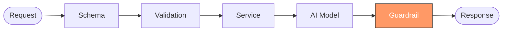
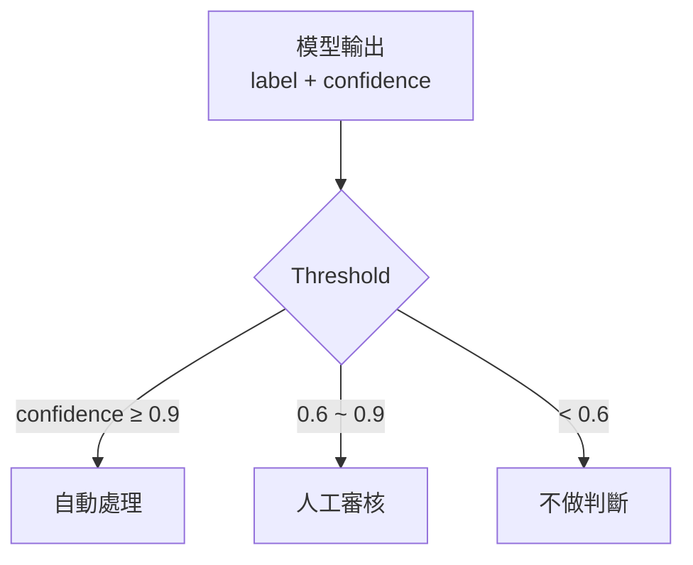

# AI 系統的防呆層

> **定位**：資料都對了，但 AI 的判斷不一定能信——系統怎麼決定要不要採取行動？

## 學習目標

完成本節後，你應該能夠：
- 區分「模型輸出」和「系統決策」的責任
- 設計一套 threshold-based 的決策分流機制
- 在 FastAPI 中實作 guardrail service
- 把 AI 決策結果轉換為可追蹤的事件

## 範例程式碼

- [demo](https://github.com/4-learn/fastapi-demo/tree/main/ai-guardrail)

---

## 情境

你的事件 API 已經做到：Schema 擋住格式錯誤、Validation 擋住語意不合理、Error Handling 統一了錯誤回應。進入 service 的資料是乾淨且可信的。

但現在你接上了一個 AI 模型。模型回傳：

```json
{
  "label": "fraud",
  "confidence": 0.62
}
```

PM 問你：「所以這筆交易要擋掉嗎？」

你不知道。0.62 算高嗎？模型說 fraud 就是 fraud 嗎？上次模型說某筆是 fraud，結果是正常交易，客戶打電話來罵。

問題不在模型準不準。問題是：**系統拿到模型結果之後，該做什麼？**

---

## 講解

### 防呆層在哪？

前面幾章處理的都是「進來的資料對不對」。這一章處理的是「出去的判斷能不能用」。



Guardrail 不在模型前面，在模型後面。它的工作不是過濾輸入，是**審查輸出**。

### 模型負責算，系統負責決定

AI 模型回傳的 confidence 是一個參考數字，不是決策。

把 `prediction = "fraud"` 直接當成事實來用，跟把使用者輸入直接塞進 SQL 一樣危險——差別只在一個炸資料庫，一個炸業務。

所以系統需要一層轉換：



門檻值不是模型決定的，是**系統根據風險承受度決定的**。同一個模型，用在醫療判斷和用在推薦系統，門檻值應該完全不同。

### 用 Pydantic 定義結構

模型輸出：

```python
class Prediction(BaseModel):
    label: str
    confidence: float = Field(ge=0.0, le=1.0)
```

系統決策：

```python
class RiskLevel(str, Enum):
    HIGH = "high"
    MEDIUM = "medium"
    LOW = "low"

class Action(str, Enum):
    AUTO_BLOCK = "auto_block"
    REQUIRE_REVIEW = "require_review"
    DEFER = "defer"

class DecisionResponse(BaseModel):
    prediction: str
    confidence: float
    risk_level: RiskLevel
    action: Action
    reason: str
```

兩個 model 分開定義，因為它們的責任不同。`Prediction` 是模型的事，`DecisionResponse` 是系統的事。

### 實作 Guardrail Service

門檻值集中管理，不散落在程式碼各處：

```python
THRESHOLDS = {
    "auto": 0.9,
    "review": 0.6,
}

def evaluate(prediction: Prediction) -> DecisionResponse:
    if prediction.confidence >= THRESHOLDS["auto"]:
        return DecisionResponse(
            prediction=prediction.label,
            confidence=prediction.confidence,
            risk_level=RiskLevel.HIGH,
            action=Action.AUTO_BLOCK,
            reason="信心值足夠，系統自動處理",
        )

    if prediction.confidence >= THRESHOLDS["review"]:
        return DecisionResponse(
            prediction=prediction.label,
            confidence=prediction.confidence,
            risk_level=RiskLevel.MEDIUM,
            action=Action.REQUIRE_REVIEW,
            reason="信心值不足以自動處理，轉人工審核",
        )

    return DecisionResponse(
        prediction=prediction.label,
        confidence=prediction.confidence,
        risk_level=RiskLevel.LOW,
        action=Action.DEFER,
        reason="信心值過低，系統不做判斷",
    )
```

重點：`evaluate()` 是純函式，不碰 HTTP、不碰資料庫。它只做一件事——根據規則把模型輸出轉成系統決策。門檻值要調？改 `THRESHOLDS` 就好，不用翻遍程式碼找 `if confidence < 0.7`。

### 決策也是事件

跟 Error Handling 那章一樣的邏輯：錯誤是事件，決策也是事件。

```python
class DecisionEvent(BaseModel):
    event_type: str = "ai_decision"
    source_event_id: str
    prediction: str
    confidence: float
    risk_level: str
    action: str
    timestamp: datetime

def to_event(source_event_id: str, decision: DecisionResponse) -> DecisionEvent:
    return DecisionEvent(
        source_event_id=source_event_id,
        prediction=decision.prediction,
        confidence=decision.confidence,
        risk_level=decision.risk_level.value,
        action=decision.action.value,
        timestamp=datetime.now(),
    )
```

每次 AI 做出判斷，系統就產生一筆事件。這筆事件可以追蹤、可以回溯、可以拿來分析模型表現。

### 串進 FastAPI

```python
class EventBody(BaseModel):
    event_id: str
    prediction: Prediction

@app.post("/evaluate")
def evaluate_prediction(body: EventBody):
    decision = evaluate(body.prediction)
    event = to_event(body.event_id, decision)

    return {
        "decision": decision.model_dump(),
        "event": event.model_dump(),
    }
```

Endpoint 只負責接資料、呼叫 service、回傳結果。邏輯在 `evaluate()`，結構在 Pydantic model。

### 整體責任對照

| 層級 | 責任 | 擋什麼 | HTTP Status |
|------|------|--------|:-----------:|
| Schema | 結構正確 | 缺欄位、型別錯 | 422 |
| Validation | 語意合理 | 負數金額、未來日期 | 422 |
| Error Handling | 邏輯拒絕 | 不支援的 event_type | 400 / 404 |
| **Guardrail** | **判斷可信度** | **低信心預測、模型不確定** | **200**（含決策） |

注意 Guardrail 回的是 200——它不是錯誤，是系統的正常決策流程。「我不確定」是一種合法的回應。

---

## Workshop

### 題目

接手一個已經能運作的事件 API，現在要加上 AI 防呆層。

模型會回傳 `Prediction`（label + confidence），你的任務是：

1. **定義 Schema** — `RiskLevel`、`Action` enum 和 `DecisionResponse`、`DecisionEvent` model
2. **實作 `evaluate()`** — 根據 threshold 把模型輸出轉成系統決策
3. **實作 `to_event()`** — 把決策轉成可追蹤的事件
4. **完成 `/evaluate` endpoint** — 串接以上邏輯

### 預期輸出

高信心（confidence = 0.95）：

```json
{
  "decision": {
    "prediction": "fraud",
    "confidence": 0.95,
    "risk_level": "high",
    "action": "auto_block",
    "reason": "信心值足夠，系統自動處理"
  },
  "event": {
    "event_type": "ai_decision",
    "source_event_id": "txn_001",
    "prediction": "fraud",
    "confidence": 0.95,
    "risk_level": "high",
    "action": "auto_block",
    "timestamp": "2025-01-10T11:00:00"
  }
}
```

中信心（confidence = 0.68）：

```json
{
  "decision": {
    "prediction": "fraud",
    "confidence": 0.68,
    "risk_level": "medium",
    "action": "require_review",
    "reason": "信心值不足以自動處理，轉人工審核"
  }
}
```

低信心（confidence = 0.42）：

```json
{
  "decision": {
    "prediction": "fraud",
    "confidence": 0.42,
    "risk_level": "low",
    "action": "defer",
    "reason": "信心值過低，系統不做判斷"
  }
}
```

### 解答

- [解答](https://github.com/4-learn/fastapi-workshop/tree/main/ai-guardrail)

---

原始課綱：[AI 系統的防呆層](https://hackmd.io/@yillkid/BkgnuPyHZx)
