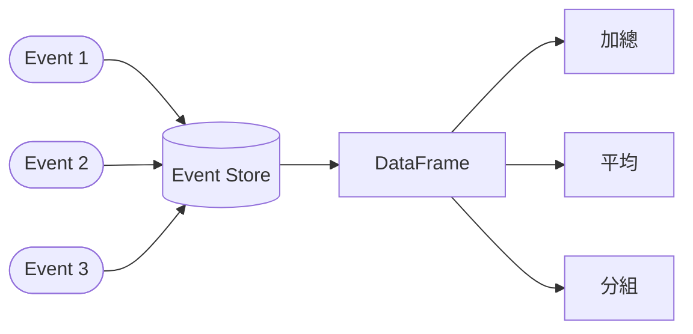
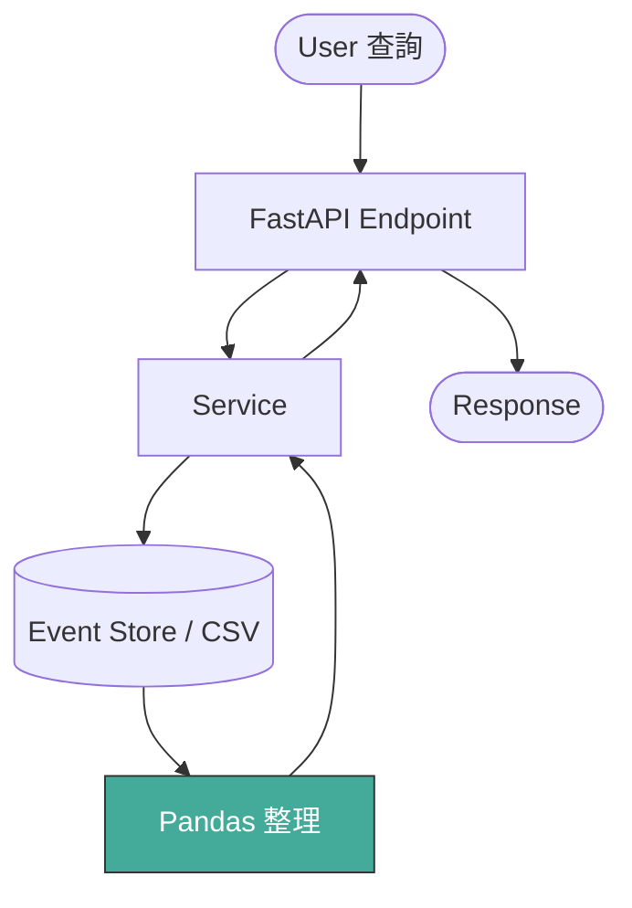

# 事件資料流：FastAPI × Pandas

> **定位**：事件已經能即時處理，但使用者開始問「系統記得什麼？」——什麼時候該把事件整理成 DataFrame？

## 學習目標

完成本節後，你應該能夠：
- 區分「事件」和「DataFrame」的角色差異
- 判斷什麼情境該查歷史、什麼情境不該
- 在 service 層使用 Pandas 整理歷史事件
- 把整理後的結果透過 API 回傳

## 範例程式碼

- [demo](https://github.com/4-learn/fastapi-demo/tree/main/pandas)

---

## 情境

你的事件 API 能收事件、能驗資料、能做 AI 判斷。系統跑了一陣子，累積了幾千筆事件。

然後使用者來問：

> 「我今天交易了幾次？總金額多少？」

你的 API 收到的是一個 GET request，不是一個 event。使用者不是要觸發什麼行為，而是要系統**回顧過去發生的事**。

這跟前面幾章處理的問題完全不同。前面是「進來一筆資料，系統該怎麼反應」。現在是「系統記得什麼，怎麼整理給使用者看」。

---

## 講解

### Event 和 DataFrame 不是同一種東西

Event 是一次性的事實。它發生過，就存在了：

```json
{
  "event_type": "transaction",
  "user_id": 123,
  "amount": 500,
  "timestamp": "2025-01-10T10:30:00"
}
```

DataFrame 是一種觀察角度。同樣的事件，可以用不同方式整理：按時間排、按金額加總、按類型分組。它不是事實本身，是你選擇怎麼看事實。



### 資料流：誰負責什麼



幾個規則：

| 元件 | 可以做 | 不該做 |
|------|--------|--------|
| FastAPI Endpoint | 定義查詢參數、回傳結果 | 直接操作 DataFrame |
| Service | 讀 DB、呼叫 Pandas、組合結果 | 處理 HTTP 細節 |
| Pandas | 篩選、聚合、統計 | 直接面對使用者 |
| DB / Event Store | 儲存事實 | 做運算 |

Pandas 永遠不直接面對使用者。它在 service 裡面，安靜地把資料整理好，交給上層回傳。

### 為什麼一定要先存再整理？

你可能會想：收到 event 的時候直接用 Pandas 算不就好了？

不行。原因很實際：

- 系統會重啟，記憶體裡的 DataFrame 會消失
- 規則會改，你需要用新規則重新跑歷史資料
- 出事的時候你需要 audit，要能回放每一筆事件

所以流程是：event 先進 DB（或 CSV），需要的時候再撈出來變 DataFrame。Event 是永久的，DataFrame 是暫時的。

### 用 Pandas 整理歷史事件

假設事件存在 CSV 裡（正式環境會是 DB，但邏輯一樣）：

```csv
event_id,user_id,event_type,amount,confidence,timestamp
e001,123,transaction,500,0.82,2025-01-10T10:30:00
e002,123,transaction,800,0.91,2025-01-10T11:10:00
e003,123,transaction,1200,0.65,2025-01-10T12:00:00
e004,456,transaction,300,0.40,2025-01-10T12:30:00
```

Service 裡的整理函式：

```python
import pandas as pd
from pathlib import Path

DATA_PATH = Path(__file__).parent / "events.csv"

def get_user_summary(user_id: int) -> dict:
    df = pd.read_csv(DATA_PATH)
    user_df = df[df["user_id"] == user_id]

    if user_df.empty:
        return {
            "user_id": user_id,
            "total_events": 0,
            "total_amount": 0,
            "avg_confidence": None,
            "note": "no historical events",
        }

    return {
        "user_id": user_id,
        "total_events": len(user_df),
        "total_amount": float(user_df["amount"].sum()),
        "avg_confidence": round(float(user_df["confidence"].mean()), 2),
    }
```

注意 `user_df.empty` 的處理——查不到歷史不是錯誤，是「系統還沒有這個人的紀錄」。回傳一個安全結構，而不是炸 500。

### 進階：按類型分組統計

有時候使用者不只要總數，還要知道「哪種事件最多」：

```python
def get_event_breakdown(user_id: int) -> dict:
    df = pd.read_csv(DATA_PATH)
    user_df = df[df["user_id"] == user_id]

    if user_df.empty:
        return {"user_id": user_id, "breakdown": {}}

    grouped = user_df.groupby("event_type").agg(
        count=("event_id", "count"),
        total_amount=("amount", "sum"),
        avg_confidence=("confidence", "mean"),
    )

    return {
        "user_id": user_id,
        "breakdown": {
            event_type: row.to_dict()
            for event_type, row in grouped.iterrows()
        },
    }
```

`groupby` + `agg` 是 Pandas 最常用的組合。一行搞定「按 X 分組，算 Y 的總和/平均/次數」。

### 串進 FastAPI

```python
@app.get("/users/{user_id}/summary")
def user_summary(user_id: int):
    return get_user_summary(user_id)

@app.get("/users/{user_id}/breakdown")
def user_breakdown(user_id: int):
    return get_event_breakdown(user_id)
```

Endpoint 很乾淨：收參數、呼叫 service、回傳。沒有 `pd.read_csv`，沒有 `df[...]`。DataFrame 的操作全部收在 service 裡。

### 這些結果可以交給 LLM

Pandas 整理出來的是結構化資料：

```json
{
  "user_id": 123,
  "total_events": 3,
  "total_amount": 2500,
  "avg_confidence": 0.79
}
```

如果你要接 LLM，它的角色是把這些數字「說成人話」——解釋趨勢、提供建議。但 LLM 不碰 DB、不碰 Pandas，它只是最後一層的翻譯。

---

## Workshop

### 題目

使用者透過 API 查詢自己的歷史交易狀況。你要實作一個 service function，從 `events.csv` 讀取資料並回傳摘要。

1. **實作 `get_user_risk_summary()`** — 篩選指定 user，回傳交易次數、總金額、平均 confidence
2. **處理邊界情況** — user 不存在時回傳安全結構（不是 error）
3. **串接 FastAPI endpoint** — `GET /users/{user_id}/summary`

### 預期輸出

User 123（有歷史資料）：

```json
{
  "user_id": 123,
  "total_events": 3,
  "total_amount": 2500.0,
  "avg_confidence": 0.79
}
```

User 999（無歷史資料）：

```json
{
  "user_id": 999,
  "total_events": 0,
  "total_amount": 0,
  "avg_confidence": null,
  "note": "no historical events"
}
```

### 解答

- [解答](https://github.com/4-learn/fastapi-workshop/tree/main/pasdas)