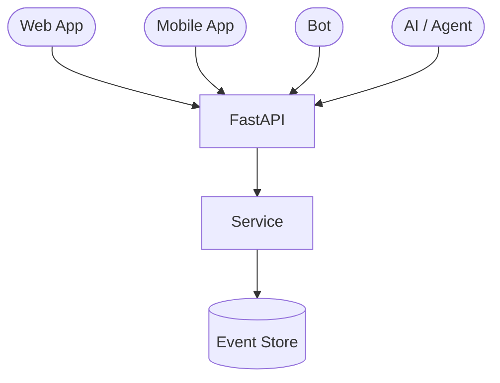
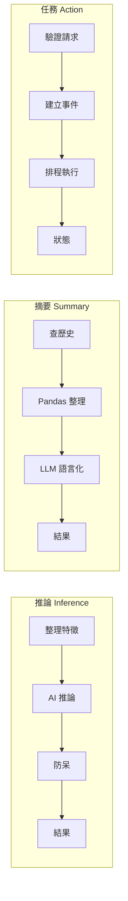
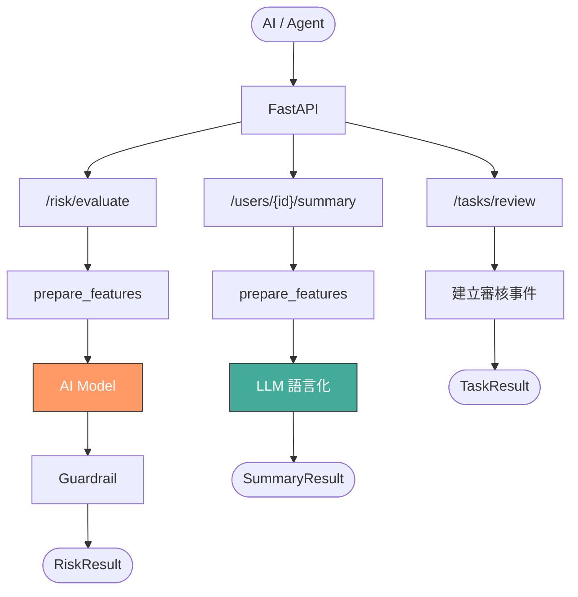

# LLM 管道：FastAPI × AI Pipeline

> **定位**：前面學的 FastAPI 不只是在寫 API——它是 AI 系統的入口。AI 怎麼「使用」你的系統？

## 學習目標

完成本節後，你應該能夠：
- 理解 AI / LLM / Agent 在系統中的角色是「使用者」，不是「主人」
- 區分三種 pipeline：推論、摘要、任務觸發
- 在 FastAPI 中實作三種 pipeline 的 endpoint
- 設計讓 Agent 能使用、但不能繞過防線的 API

## 範例程式碼

- [demo](https://github.com/4-learn/fastapi-demo/tree/main/llm-pipeline)

---

## 情境

你的系統已經有了完整的事件處理鏈：Schema、Validation、Error Handling、AI Guardrail、Pandas 歷史整理。

現在公司要接一個 AI 助手。PM 說：「讓 AI 直接查資料庫，它自己會判斷。」

你覺得不太對。讓 AI 直接碰 DB，等於跳過了你前面建的所有防線——Schema 不檢查、Validation 不過、防呆不走。跟讓實習生拿到 production DB 密碼一樣。

正確的做法是：AI 透過 API 使用你的系統，跟其他 client 一樣。

---

## 講解

### AI 是系統的使用者，不是主人

Web App、Mobile App、Bot、IoT 裝置，都是透過 API 跟你的系統互動。AI / LLM / Agent 也一樣——它只是另一種 client。



所有 client 走同一套 API，就代表走同一套 Schema、同一套 Validation、同一套防呆。AI 不該有特權。

### 三種 Pipeline

AI 對系統的需求，基本上就三種：



| Pipeline | 做什麼 | 誰負責運算 | API 回什麼 |
|----------|--------|-----------|-----------|
| 推論 | 判斷風險 / 分類 | AI 模型 | risk_level + action |
| 摘要 | 回顧歷史 | Pandas（+ LLM） | 統計 + 敘述 |
| 任務觸發 | 請系統做事 | Service | task_id + status |

### Pipeline 1：推論（Inference）

AI 來問：「這個使用者是不是高風險？」

系統不是直接把資料丟給 AI。流程是：

1. 從 Event Store 撈歷史事件
2. 用 Pandas 整理成特徵（次數、金額、平均信心值）
3. 把特徵交給 AI 模型
4. 拿到模型結果，走防呆邏輯
5. 回傳最終決策

```python
def prepare_features(user_id: int) -> dict:
    """從 Event Store 整理特徵，給 AI 用"""
    df = pd.read_csv(DATA_PATH)
    user_df = df[df["user_id"] == user_id]

    if user_df.empty:
        return {"user_id": user_id, "total_events": 0,
                "total_amount": 0, "avg_confidence": None}

    return {
        "user_id": user_id,
        "total_events": len(user_df),
        "total_amount": float(user_df["amount"].sum()),
        "avg_confidence": round(float(user_df["confidence"].mean()), 2),
    }


def evaluate_risk(user_id: int) -> RiskResult:
    features = prepare_features(user_id)
    prediction = ai_predict(features)  # AI 模型（黑盒）

    # 防呆：低信心不自動處理
    if prediction["confidence"] >= 0.8:
        action = "auto_flag"
    elif prediction["confidence"] >= 0.6:
        action = "require_review"
    else:
        action = "defer"

    return RiskResult(
        user_id=user_id,
        risk_level=prediction["label"],
        confidence=prediction["confidence"],
        action=action,
        features=features,
    )
```

重點：AI 模型拿到的是整理好的特徵，不是 raw event。系統控制 AI 看到什麼。

### Pipeline 2：摘要（Summarization）

AI 來問：「這個使用者最近的行為如何？」

這不需要模型推論，需要的是歷史回顧。Pandas 是摘要的第一層，LLM 是可選的第二層——把數字翻譯成人話。

```python
def summarize_user(user_id: int, use_llm: bool = False) -> SummaryResult:
    features = prepare_features(user_id)

    narrative = None
    if use_llm and features["total_events"] > 0:
        narrative = llm_summarize(features)  # LLM 語言化

    return SummaryResult(
        user_id=user_id,
        total_events=features["total_events"],
        total_amount=features["total_amount"],
        avg_confidence=features["avg_confidence"],
        narrative=narrative,
    )
```

`?llm=true` 才觸發 LLM。結構化資料永遠回傳，自然語言是加值。

### Pipeline 3：任務觸發（Action）

AI 來說：「請幫這個使用者建立人工審核任務。」

API 不只回資料，也可以觸發系統行為。但 AI 只能「請求」，不能「執行」——系統驗證完才決定要不要做。

```python
def create_review_task(user_id: int, reason: str) -> TaskResult:
    return TaskResult(
        task_id=str(uuid4())[:8],
        status="pending",
        created_at=datetime.now(),
    )
```

回傳 `pending`，不是 `done`。系統排程後才執行，AI 不能跳過這一步。

### 三條 Endpoint

```python
# Pipeline 1: 推論
@app.post("/risk/evaluate")
def risk_evaluate(req: RiskRequest):
    return evaluate_risk(req.user_id)

# Pipeline 2: 摘要
@app.get("/users/{user_id}/summary")
def user_summary(user_id: int, llm: bool = False):
    return summarize_user(user_id, use_llm=llm)

# Pipeline 3: 任務觸發
@app.post("/tasks/review")
def trigger_review(req: TaskRequest):
    return create_review_task(req.user_id, req.reason)
```

每個 endpoint 背後是不同的 pipeline，但對 AI 來說都只是「呼叫 API」。它不需要知道裡面有沒有 Pandas、有沒有防呆——那是系統的事。

### 整體資料流



### 為什麼 AI 不該直接碰 DB？

| 直接碰 DB | 透過 API |
|-----------|---------|
| 跳過 Schema 驗證 | 走完整驗證流程 |
| 無法控管查詢範圍 | Service 決定給什麼 |
| 難以 audit | 每個 request 都有紀錄 |
| AI 出錯 → 直接影響資料 | AI 出錯 → 被防呆攔住 |

---

## Workshop

### 題目

設計一個 AI 助手能使用的 API 系統。AI 不能直接碰 DB，只能透過你的 API。

實作三種 pipeline：

1. **推論型 `POST /risk/evaluate`**
   - 收 `user_id`
   - 從 `events.csv` 整理特徵
   - 呼叫 `fake_ai_predict()`（已提供）
   - 加上防呆邏輯（confidence 門檻）
   - 回傳 `RiskResult`

2. **摘要型 `GET /users/{user_id}/summary`**
   - 整理歷史事件
   - 支援 `?llm=true` 觸發 `fake_llm_summarize()`（已提供）
   - 回傳 `SummaryResult`

3. **任務型 `POST /tasks/review`**
   - 收 `user_id` + `reason`
   - 產生 `task_id`，回傳 `pending` 狀態

### 預期輸出

推論（user 123）：

```json
{
  "user_id": 123,
  "risk_level": "medium_risk",
  "confidence": 0.65,
  "action": "require_review",
  "features": {
    "user_id": 123,
    "total_events": 3,
    "total_amount": 2500.0,
    "avg_confidence": 0.79
  }
}
```

摘要（user 123, llm=true）：

```json
{
  "user_id": 123,
  "total_events": 3,
  "total_amount": 2500.0,
  "avg_confidence": 0.79,
  "narrative": "使用者 123 共有 3 筆交易，總金額 2500.0，平均信心值 0.79。"
}
```

任務觸發：

```json
{
  "task_id": "a1b2c3d4",
  "status": "pending",
  "created_at": "2025-01-10T14:00:00"
}
```

### 解答

- [解答](https://github.com/4-learn/fastapi-workshop/tree/main/llm-pipeline)