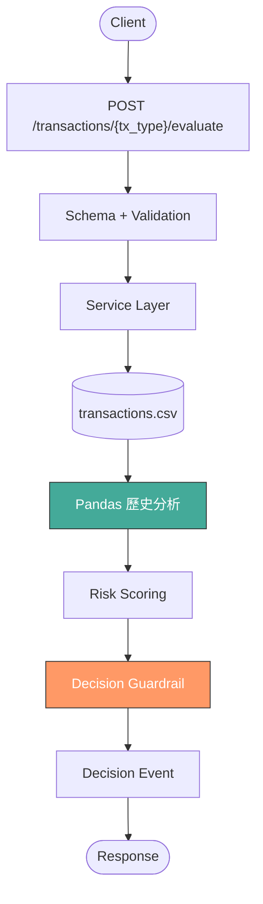

# 綜合 Workshop：AI 事件處理系統

> **承接**：Day 2 所有內容（Error Handling → Guardrail → Pandas → LLM Pipeline）
> **目標**：從零建一個完整的交易風險評估 API，串接所有學過的概念

---

## 情境

你是一間電商公司的後端工程師。資料科學團隊在 Jupyter Notebook 裡做了一個詐欺偵測模型，現在要上線。

目前的狀況：
- 模型跑在 notebook 裡，沒有 API
- 交易資料存在 CSV 裡
- 沒有驗證、沒有錯誤處理、沒有 audit trail
- PM 說：「下週要上線」

你的任務：把這個 notebook 模型包成一個 production-ready 的 API 系統。

---

## 系統架構



---

## 五個階段

### 階段 1：專案結構

建立模組化結構：

```
app/
├── main.py
├── routers/
│   └── transactions.py
├── schemas/
│   └── transaction.py
├── services/
│   ├── risk_service.py
│   └── history_service.py
└── data/
    └── transactions.csv
```

### 階段 2：事件入口

建立 endpoint：

```
POST /transactions/{tx_type}/evaluate
```

- Path: `tx_type`（purchase, refund, transfer）
- Body: `user_id`（int, > 0）、`amount`（float, > 0）、`currency`（str, 3 碼）、`timestamp`（datetime）

Schema + Validation 要到位。不支援的 tx_type 回 400，格式錯回 422。

### 階段 3：歷史分析

提供 `transactions.csv`：

```csv
tx_id,user_id,tx_type,amount,risk_score,timestamp
t001,123,purchase,500,0.2,2025-01-10T10:00:00
t002,123,purchase,800,0.3,2025-01-10T11:00:00
t003,123,purchase,5000,0.8,2025-01-10T12:00:00
t004,456,purchase,200,0.1,2025-01-10T10:30:00
t005,456,refund,100,0.15,2025-01-10T11:30:00
```

在 `history_service.py` 用 Pandas 整理：
- 該使用者的交易次數
- 平均金額
- 最近的平均 risk_score

### 階段 4：風險評分

在 `risk_service.py` 實作 rule-based 風險評分（模擬 AI）：

```python
def calculate_risk(amount: float, history: dict) -> float:
    """
    規則：
    - 基礎分 = amount / 10000（金額越大風險越高）
    - 如果歷史平均 risk_score > 0.5，加 0.2
    - 如果交易次數 < 3（新用戶），加 0.1
    - 上限 1.0
    """
```

### 階段 5：決策防呆

根據 risk_score 決定系統行動：

| Risk Score | 行動 | 說明 |
|:----------:|------|------|
| < 0.3 | `auto_approve` | 自動通過 |
| 0.3 ~ 0.7 | `require_review` | 人工審核 |
| > 0.7 | `auto_block` | 自動擋下 |

把決策結果包成 Decision Event 回傳。

---

## 預期輸出

低風險交易（user 456, amount 200）：

```json
{
  "decision": {
    "risk_score": 0.12,
    "action": "auto_approve",
    "reason": "低風險，自動通過"
  },
  "event": {
    "event_type": "risk_decision",
    "user_id": 456,
    "tx_type": "purchase",
    "risk_score": 0.12,
    "action": "auto_approve",
    "timestamp": "2025-01-10T14:00:00"
  }
}
```

高風險交易（user 123, amount 50000）：

```json
{
  "decision": {
    "risk_score": 0.95,
    "action": "auto_block",
    "reason": "高風險，自動擋下"
  },
  "event": {
    "event_type": "risk_decision",
    "user_id": 123,
    "tx_type": "purchase",
    "risk_score": 0.95,
    "action": "auto_block",
    "timestamp": "2025-01-10T14:00:00"
  }
}
```

不支援的交易類型：

```json
{
  "status": "rejected",
  "event_type": "withdrawal",
  "reason": "Unsupported transaction type: withdrawal"
}
```

---

## 開發順序建議

1. 先把專案結構建好（階段 1）
2. 先做最簡單的 endpoint，回 hardcode 的 response（階段 2）
3. 加上歷史查詢（階段 3）
4. 加上風險評分（階段 4）
5. 最後加防呆（階段 5）

每個階段都用 Swagger 測試確認沒問題，再往下做。

---

## 解答

- [解答](https://github.com/4-learn/fastapi-workshop/tree/main/camera-event)

---

原始課綱：[Day 2 綜合 Workshop](https://hackmd.io/@yillkid/ryz-B5bvbe)
